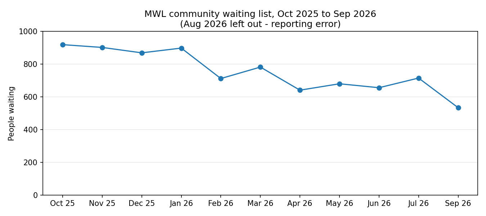
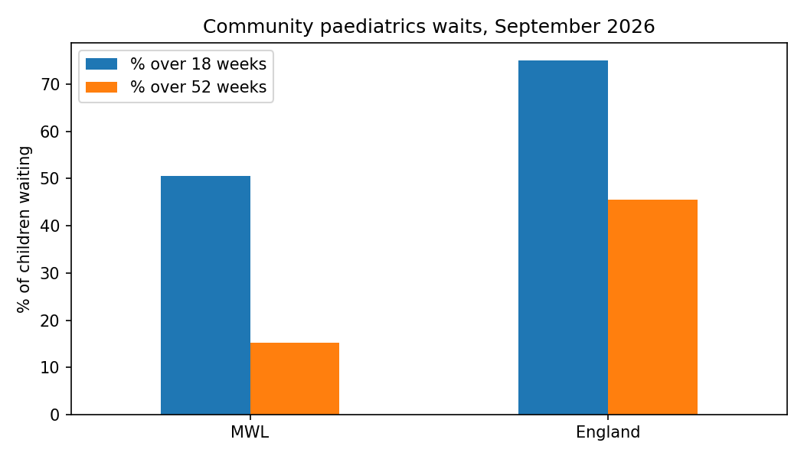

# MWL Community Waiting Lists (Oct 2025 – Sep 2026)

## Why I did this
I analysed NHS England's community health services waiting list data for Mersey and West Lancashire Teaching Hospitals (MWL), to learn community services data before applying for an analyst role there.

## Data
- Source: NHS England, Community Health Services (CHS) SitRep, monthly publication
- Period: October 2025 to September 2026 (12 monthly files)
- Provider: Mersey and West Lancashire Teaching Hospitals NHS Trust (code RBN)
- Comparison: England totals for the same months and services

## What I did
Using Python in Google Colab, I combined the total and eight wait band tabs from all 12 files, kept the MWL and England rows, and reshaped them into one table. I then calculated the share waiting over 18 and 52 weeks and compared MWL with England for the same service. Waiting lists are a monthly snapshot, so I never added months together.

## Findings
- MWL's community waiting list fell from 919 in October 2025 to 534 in September 2026, a drop of about 42%.
- Community paediatrics is the biggest list, with 301 of the 534 people waiting (56%) in September 2026.
- About half of the children waiting for community paediatrics (50.5%) had waited over 18 weeks, and 15.3% over 52 weeks.
- This is well below England for the same service, where 75% had waited over 18 weeks and 45.6% over 52 weeks.
- Adult services had almost no long waits. Only continence and colostomy support had people waiting over 18 weeks (4.9%).

## Data quality notes
- **August 2026** showed 0 for every MWL service, although about 300 children were waiting before and after. I treated it as a reporting error and left it out.
- **Intermediate care** has a total but no wait band breakdown.
- I compared the **same service** for MWL and England, as MWL reports a smaller mix of services.
- NHS England describes this data as **unvalidated management information**.

## Charts

## Files
- `mwl_community_waits.ipynb`: the notebook with all the code
- `mwl_vs_england_chs.csv`: the combined, cleaned data for MWL and England
- `mwl_trend.png` and `paediatrics_vs_england.png`: the charts

## Tools
Python (pandas, matplotlib), Google Colab
